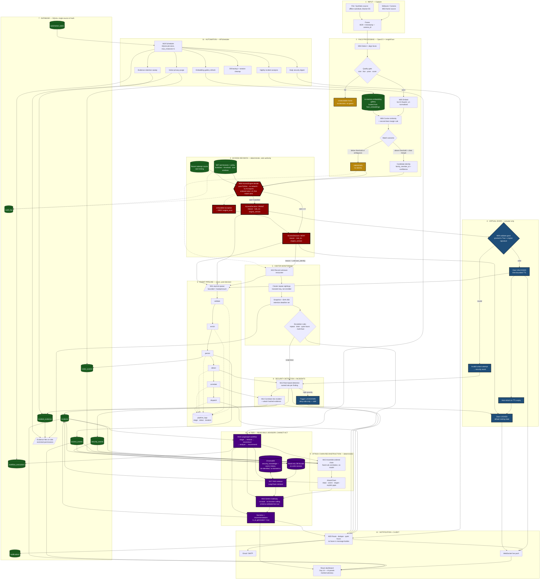

# DATA FLOW

**Project:** AI-Powered Smart Home Security and Automated Access Management System
**Version:** 1.0 (Day 1 design)
**Status:** Design only — no implementation exists

---

## 1. The One Rule This Diagram Encodes

Read the diagram below for one property above all others: **every arrow that reaches the virtual door originates at the AccessEngine, and no arrow enters the AccessEngine from the AI tier.**

The AI subgraph (Gemini, RAG, LangGraph) has inbound arrows only from the database and from the deterministic reconstruction step. Its outbound arrows go to storage, notifications and the UI. There is no path — direct or transitive — from any AI node to the AccessEngine or to the virtual door. **AI cannot unlock the door, because no edge exists for it to travel along.**

---

## 2. Complete System Data Flow

---

## 3. Reading the Diagram: Containment Verified by Edge Inspection

### 3.1 Inbound edges to `ENGINE` (M08 AccessEngine)

| From | Stage | AI involved? |
|---|---|---|
| `KNOWN` | Match result | No |
| `UNKNOWN` | Match result | No |
| `PERMS` | Permission + policy read | No |
| `RATE` | Attempt counts | No |

**Four inbound edges. None originates in the AI subgraph.**

### 3.2 Inbound edges to the door subgraph

| From | To | Note |
|---|---|---|
| `GRANT` | `VALIDATE` | The only unlock path, and it carries an AccessEngine-signed decision |
| `DENY` | `LOCKED` | Deny-side |
| `LOCKDOWN` | `LOCKED` | Deny-side, may be raised by detection or a scheduled job |
| `INVALID` | `DETECTOR` | A rejected unlock becomes a security event |

**No AI node touches the door subgraph.** The strongest action the AI tier can influence is `LOCKDOWN`, and even that is reached only via `DETECTOR`, is deny-side, and makes the system *more* locked. There is no inverse.

### 3.3 Outbound edges from AI nodes

`GEMINI → AIOUT`, `LG → AIOUT`, `LG → TWF`, `LG → RAG`, `LG → M15`, `AIOUT → TINC`, `AIOUT → NOTIF`, `AIOUT → UI`.

Every destination is storage, notification or display. **None is an actuator.** `AIOUT → TINC` writes only the advisory columns (`ai_summary`, `ai_recommendations`, `is_ai_enriched`) and never touches `permissions`, `face_embeddings` or `access_events`.

---

## 4. Trace 1 — Known Family Member Granted

| Step | Flow | Data |
|---|---|---|
| 1 | `CAM → FRAME` | BGR frame + timestamp + camera id |
| 2 | `FRAME → DETECT → QUALITY` | Bounding box, landmarks, quality verdict |
| 3 | `QUALITY → EMBED` | Aligned crop → 512-D normalised vector |
| 4 | `EMBED + GALLERY → MATCH` | Cosine scores against the in-memory gallery |
| 5 | `MATCH → KNOWN` | `member_id=7`, confidence `0.71`, margin clear |
| 6 | `KNOWN + PERMS + RATE → ENGINE` | Rules 1–8 all pass |
| 7 | `ENGINE → GRANT` | `rule 9 / permission_satisfied`, engine version recorded |
| 8 | `GRANT → VALIDATE → UNLOCK` | Signature verified; door unlocked with TTL |
| 9 | `UNLOCK → RELOCK → LOCKED` | Auto-relock returns to resting state |
| 10 | `GRANT → QUEUE` | Async handoff — **the door already opened before this point** |
| 11 | `S3 → TACCESS` | Decision row with rule, confidence, threshold, latency |
| 12 | `S6 → NOTIF → WS → UI` | Live dashboard update |

Latency note: steps 1–8 are the critical path. Steps 10–12 are asynchronous. The AI tier is not involved at any step.

## 5. Trace 2 — Unknown Visitor Denied, Escalated, Analysed

| Step | Flow | Data |
|---|---|---|
| 1–4 | As above | Face detected and embedded |
| 5 | `MATCH → UNKNOWN` | Best score below threshold |
| 6 | `UNKNOWN → ENGINE` | — |
| 7 | `ENGINE → DENY` | `rule 2 / unknown_identity`. **Door never changes state.** |
| 8 | `DENY → LOCKED` | Resting state maintained |
| 9 | `DENY → VMON → VCLUSTER → VSNAP` | Visitor event, cluster key, hashed snapshot, retention deadline |
| 10 | `VSNAP → VESCALATE` | Third denial in ten minutes → suspicious |
| 11 | `VESCALATE → DETECTOR → TSEC` | `repeated_denial`, severity high, rule named |
| 12 | `DETECTOR → INCMGR → TINC + TEVID` | Incident opened, evidence attached with SHA-256 |
| 13 | `INCMGR → NOTIF → EMAIL + WS` | Operator alerted, deduplicated |
| 14 | `TINC → M15 → CHAIN` | **Deterministic** ordered chain: sighting → denial → repetition → escalation |
| 15 | `CHAIN + RAG → GEMINI → AIOUT` | Narrative + recommendations, schema-validated |
| 16 | `AIOUT → TINC → UI` | Stored as advisory, labelled in the UI |

The decisive observation: the outcome at step 7 was final. Steps 14–16 produced description, not decision. Removing the entire AI tier would change nothing about whether that person got in.

## 6. Trace 3 — Scheduled Privacy Purge

`TTASK → SCHED → JPURGE → TVISITOR + EVFILES`, with the run recorded in `TWF`.

The job deletes visitor snapshots and cluster keys past `retention_expires_at` and stamps `purged_at` as proof. This is the enforcement mechanism behind the unknown-visitor privacy promise in `SECURITY_REQUIREMENTS.md` §5. Note the absence of any edge from `JPURGE` to the door subgraph: **no scheduled job can unlock.**

---

## 7. Failure-Mode Flows

| Failure | Flow | Door outcome |
|---|---|---|
| Camera offline | No `FRAME`; `DETECTOR` raises `camera_offline` | **LOCKED** — absence of input is never a grant |
| Poor frame quality | `QUALITY → UNDECIDABLE`; flow stops | **LOCKED** — no guess attempted |
| Model weights missing | `EMBED` fails → no identity → `ENGINE` rule 2 | **LOCKED** |
| Ambiguous match | `MRESULT → UNKNOWN` via margin rule | **LOCKED** |
| Database unreadable | `PERMS` read fails → `ERRGUARD` | **LOCKED** — `engine_error` |
| Engine exception | `ENGINE → ERRGUARD → DENY` | **LOCKED** |
| Pipeline queue full | Enrichment shed; access events never dropped | **Unaffected** |
| Gemini down | `GEMINI` path skipped; incident stays unenriched | **Unaffected** |
| ChromaDB down | `RAG` returns nothing; Gemini runs without context | **Unaffected** |
| LangGraph failure | `TWF` records last node reached | **Unaffected** |
| Scheduler down | Retention and digests deferred | **Unaffected** |
| Notification failure | Recorded in `TNOTIF`, retried | **Unaffected** |

Every row in the top half resolves to LOCKED, and every row in the bottom half leaves the door untouched. That pattern is principle P3 (fail secure) made visible.

---

## 8. Trust Boundaries Crossed

| Boundary | Crossing | Control |
|---|---|---|
| Physical → System | Camera frame | Quality gate; frames are data, never commands |
| Client → API | HTTP/WS request | JWT, RBAC, Pydantic validation, rate limiting |
| System → Database | Repository write | Parameterised statements only; FK enforcement |
| Database → AI tier | Read-only facade | No write session is ever handed to the AI tier |
| AI tier → Storage | Advisory columns only | Schema-constrained; `is_ai_generated` flag |
| System → Gemini | Outbound HTTPS | The only egress; untrusted input delimited; no tools enabled |
| System → Disk | Evidence file | Restricted permissions; outside web root; SHA-256 at capture |
| System → Operator | Notification | No biometric content in message bodies |

---

## 9. Status

This document describes intended flow. **No component in it has been built, and no flow has been executed or measured.** Implementation of the capture-to-decision path begins Day 3 and completes Day 4; the pipeline lands Day 6; the AI tier lands Days 8–11.
